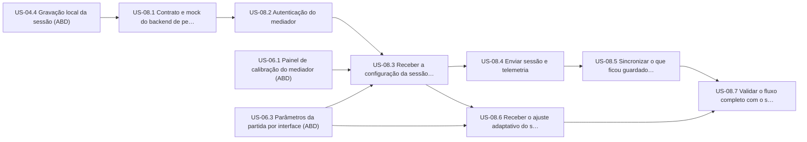

# Help-IR — conexão com a API

> **Este arquivo não é backlog ativo.** Pela decisão do orientador ("os três projetos precisam criar um arquivo local,
> conexão com API vem num outro momento", 25/11/2026), o jogo grava a telemetria e o registro só em arquivo local, e a
> conexão com o `research.ciatec.org` é de outro momento. Em 26/11/2026 ele mandou tirar do backlog toda história, task
> e spike de servidor ou API e guardá-las aqui, inteiras, para não se perderem. O backlog do jogo, com os milestones Core
> e Expansão, é o `ABD-1-Caique.md`, ao lado. Estas histórias não têm milestone nem data; voltam quando o orientador
> abrir a conexão com a API.

**Histórico.** v0.1 (26/11/2026): as antigas US-08.1 a US-08.7 do `ABD-1-Caique.md` (v0.3, milestone "Conexão com a
API"), movidas para cá sem mudança de conteúdo, com o dono [agente] ou [aluno] de cada task da v0.4 do ABD. v0.2
(26/11/2026): recebe do ABD v0.5 a exclusão dos dados de um participante no servidor, que era um estado registrado na
US-10.10 e na US-M2 de lá. v0.3 (26/11/2026): alinhado ao ABD v0.7 — o agente escreve os testes e o aluno os roda no
Test Runner, sem linha de comando. v0.4 (26/11/2026): alinhado ao ABD v0.9 e ao SGDD v1.3 — a regra de adaptação (o
ajuste durante a fase e o avanço e a regressão entre partidas) roda no backend (decisão do orientador, padrão CIATEC); o
jogo recebe a fase e os parâmetros pela `IProvedorDeParametros` (US-06.3 do ABD), que o cliente da API implementa; a
US-08.6 absorve o aplicador do ajuste durante a fase, que era da US-04.7 do ABD, cortada (4 h → 5 h); ética,
consentimento e dados são tratados fora do jogo (a US-10.1, a US-10.2, a US-10.9 e a US-10.10 do ABD foram cortadas); a
antiga US-07.1 do ABD (v0.11) (modelo de eventos registrado) foi cortada, e os eventos são os da LAC-21; o dispositivo-alvo é o PC.

## 1 Sumário

- **7 histórias, 18 SP, 23 tasks (21 [agente] e 2 [aluno]), 29 h** (27 h [agente] e 2 h [aluno]), do épico EP-08 do
  ABD: contrato e mock, autenticação do mediador, configuração recebida, envio, sincronização, ajuste do servidor e
  validação do fluxo.
- **Partem do ABD:** do Core, o arquivo local da sessão (US-04.4, com o código do participante, T-04.4.3) e os eventos e
  as amostras que ela grava (US-04.3); da Expansão (desde o corte de protótipo, v0.10 do ABD), o painel do mediador (US-06.1) e a interface que recebe os parâmetros da partida (US-06.3). Nenhuma
  história do ABD depende destas.
- **Dependência externa:** o painel de calibração, a regra de adaptação (o ajuste durante a fase e o avanço e a
  regressão entre partidas), o consentimento e o relatório no servidor são da equipe do `research.ciatec.org`
  (`ciatec-paradigma.md`; LAC-15 e LAC-22 do ABD).
- **Os números das tasks** (TASK-136 a TASK-157 e TASK-249) estão aposentados no ABD e só valem aqui.

## 1A Onde roda a regra de adaptação

Decisão do orientador (26/11/2026, padrão CIATEC; SGDD v1.3, ABD v0.9): **a regra de adaptação roda no backend**, e o
jogo não a calcula.

- **O backend roda:** o ajuste silencioso durante a fase (SGDD §4.2 D, §4.3 GP-04, §11.3 B.1, com os limiares da LAC-04
  do ABD como proposta) e o avanço e a regressão entre partidas (§4.3, §11.2, §11.3 B.2, com as escolhas da LAC-30 e da
  LG-Cai-07 do ABD como proposta).
- **O jogo manda:** a telemetria e o registro da sessão (US-04.3 e US-04.4, com o código do participante), os resultados
  de cada partida e as escolhas do mediador no painel (perfil, fase liberada ou de volta, calibração; US-06.1), que são
  decisão humana.
- **O jogo recebe:** a fase e os parâmetros da próxima partida pela `IProvedorDeParametros` (US-06.3 do ABD), que o
  cliente da API implementa (US-08.3), e o ajuste durante a fase (US-08.6). Aplica o que recebe sem nada na tela e grava
  no registro o que recebeu e a origem.
- **Sem rede**, e enquanto a API não existe, o `ProvedorLocalDeParametros` do ABD devolve os parâmetros fixos do preset da
  fase, sem regra de desempenho, e não há ajuste durante a fase.

## 2 Lacunas que valem aqui

As decisões provisórias abaixo estão nas lacunas do `ABD-1-Caique.md`; se confirmam com o pesquisador ao abrir a conexão com a API.

| Lacuna do ABD | Decisão provisória para a conexão com a API |
| --- | --- |
| LAC-14 Forma de integração e contrato | Cliente próprio atrás de `IResearchBackend`, com mock; contrato em JSON Schema tomando o `manifesto-api.md` como referência; login do mediador, fora do fluxo da criança |
| LAC-22 Ajuste adaptativo sem conexão | **Decidida pelo orientador (26/11/2026):** a regra é do backend. Com rede, o ajuste e a fase vêm dele; sem rede, valem os parâmetros fixos do preset da fase, sem ajuste (US-06.3 do ABD) |
| LAC-29 Internet e offline-first | A Internet serve ao login do mediador, à configuração e à sincronização, e o jogo continua rodando sem rede com a última configuração |
| LAC-05 Telemetria offline-first | A sincronização lê o arquivo local que o ABD já grava (US-04.4) |
| LAC-16 CEP e LGPD | Tratados fora do jogo, no CEP e no backend (decisão do orientador, 26/11/2026). No jogo: a sessão de teste não sobe, e o participante vai só pelo código, sem dado pessoal (T-04.4.3 do ABD) |

## 3 Critérios de conclusão (DoD)

- [ ] O contrato está escrito, e o jogo roda do menu ao fim da fase só com o mock, sem rede (roteiro 31–32)
- [ ] A configuração recebida (velocidade, fumaça, bloqueios, entregas, visibilidade das placas) substitui o dado local sem mudar a lógica do jogo (§12, §11.1 nota)
- [ ] A sessão e a telemetria chegam ao servidor (ou ao mock), e o que ficou guardado sem rede sincroniza depois (§13)
- [ ] A fase e os parâmetros da próxima partida e o ajuste durante a fase, decididos pelo backend, chegam pela `IProvedorDeParametros` e são aplicados (§4.2 D, §11.2; LAC-22)
- [ ] O fluxo Research System → jogo → telemetria → resultados → Research System está validado contra o mock, e o roteiro está pronto para o servidor real (roteiro 43)
- [ ] A sessão de teste não sobe, e o participante vai só pelo código; o consentimento e a coleta autorizada são controlados fora do jogo (CEP e backend)
- [ ] O procedimento de exclusão dos dados de um participante no servidor do `research.ciatec.org` está combinado com a equipe dele (fora do jogo; a US-10.10 do ABD foi cortada na v0.9) (LAC-16)
- [ ] Os requisitos que dependem do servidor (RT-13 e RT-14 com a configuração e o ajuste vindos dele, RT-16 no relatório do servidor) se validam aqui, pela US-08.7

## 4 Dependências

## 5 Histórias e tasks

Dono de cada task e regra dos testes: os do `ABD-1-Caique.md`. O agente escreve o código C# de runtime e os testes, que
montam o mínimo por código; o aluno os roda no Test Runner, com o Editor aberto, e passa as falhas ao agente, e faz o
que é do Editor, os documentos, os roteiros e o commit. Não há execução da Unity por linha de comando.

### US-08.1 — Contrato e mock do backend de pesquisa

**Epic:** EP-08 · **Perfil:** IC · **Story Points:** 3 · **Prioridade:** P1 · **Horas:** 5 h · **Decisão provisória:** LAC-14

Como IC,  
Quero simular usuário, sessão, configuração, fase e envio de dados atrás de um contrato escrito,  
Para que o jogo rode 100% offline como se tivesse servidor (roteiro 31–32), e a troca pelo servidor real não mude a lógica.

*Contexto:* Pela decisão da LAC-14, o jogo tem um cliente próprio e fino, atrás da interface `IResearchBackend`, com o mock como primeira implementação; o contrato (JSON Schema de configuração, sessão, telemetria e resultado) toma o `manifesto-api.md` como referência. O pacote `com.ciatec.*` não é adotado agora; a interface permite trocar depois.

**Critérios de aceite**

- [ ] `§7.4, §12` — o contrato de configuração, sessão, telemetria e resultado **está escrito** no repositório
- [ ] `roteiro 31–32` — com o mock ligado, a configuração da sessão **vem** dele
- [ ] `roteiro 31–32` — ao fim da fase, os dados **são entregues** ao mock no formato do contrato
- [ ] `roteiro 31–32` — o jogo **roda** do menu ao fim da fase sem rede

**Para quem jogar / pesquisador**

- [ ] levar o contrato à equipe do `research.ciatec.org` e anotar o que ela confirmar ou mudar

*Cenário 1: Configuração do mock.* **Dado** o mock ligado; **quando** a sessão começa; **então** a configuração vem dele.  
*Cenário 2: Envio ao mock.* **Dado** o mock; **quando** a fase termina; **então** os dados são entregues a ele no formato do contrato.  

| Task | O que fazer | Camada | h | Depende de | Pronta quando |
| --- | --- | --- | --- | --- | --- |
| TASK-136 | [agente] Interface IResearchBackend e contrato em JSON Schema no repositório, a partir do manifesto-api | `layer:docs` | 2 | — | contrato no repositório |
| TASK-137 | [agente] MockBackend local em arquivos JSON: usuário, sessão, configuração, fase, eventos, telemetria e resultados | `layer:platform` | 2 | TASK-136 | mock responde |
| TASK-138 | [agente] PlayMode: do menu ao fim da fase só com o mock, sem rede | `layer:tests` | 1 | TASK-137 | o aluno rodou no Test Runner e passou |

Labels: `user-story` `domain:backend` `priority:p1` `sp:3`

### US-08.2 — Autenticação do mediador

**Epic:** EP-08 · **Perfil:** Terapeuta · **Story Points:** 2 · **Prioridade:** P1 · **Horas:** 4 h · **Decisão provisória:** LAC-14, LAC-29

Como terapeuta,  
Quero entrar com a conta institucional,  
Para que os dados fiquem ligados ao participante certo (roteiro 17, 40).

*Contexto:* O SGDD não tem tela de login no fluxo da criança (§10.3). Pela decisão da LAC-14, o login é do mediador, uma vez por aparelho, no painel do mediador; a criança só vê o menu de três botões. Sem rede, vale o último token guardado.

**Critérios de aceite**

- [ ] `roteiro 17, 40` — credenciais válidas **guardam** o token e liberam o painel
- [ ] `§10.3-1` — o login **não aparece** no fluxo da criança
- [ ] `§13` — sem rede, o jogo **abre** com o último token e grava a sessão para sincronizar depois

**Para quem jogar / pesquisador**

- [ ] pedir à equipe do `research.ciatec.org` uma conta de teste e entrar com ela

*Cenário 1: Login.* **Dado** credenciais válidas; **quando** o mediador entra; **então** o painel libera a escolha do participante.  
*Cenário 2: Sem rede.* **Dado** um token guardado e sem rede; **quando** o jogo abre; **então** a sessão roda e fica guardada para sincronizar.  

| Task | O que fazer | Camada | h | Depende de | Pronta quando |
| --- | --- | --- | --- | --- | --- |
| TASK-139 | [agente] LoginDoMediador, com os campos [SerializeField] campoUsuario, campoSenha e botaoEntrar, fora do fluxo da criança | `layer:presentation` | 1 | — | login no código |
| TASK-249 | [aluno] Tela de login no painel do mediador, ligada aos campos do LoginDoMediador | `layer:presentation` | 1 | TASK-139 | tela conferida no Play |
| TASK-140 | [agente] Autenticação pelo IResearchBackend, com token guardado; no mock, login local | `layer:platform` | 1 | TASK-139 | login pelo mock |
| TASK-141 | [agente] Testes: credencial válida, inválida e sem rede | `layer:tests` | 1 | TASK-140 | o aluno rodou no Test Runner e passaram |

Labels: `user-story` `domain:backend` `priority:p1` `sp:2`

### US-08.3 — Receber a configuração da sessão e da fase

**Epic:** EP-08 · **Perfil:** Terapeuta · **Story Points:** 3 · **Prioridade:** P1 · **Horas:** 5 h · **Decisão provisória:** LAC-14, LAC-29

Como terapeuta,  
Quero que a fase use os parâmetros que defini no servidor,  
Para que eu calibre a sessão pela criança (RT-13).

*Contexto:* A configuração chega pelo `IResearchBackend` (o mock ou o servidor). O cliente implementa a `IProvedorDeParametros` da US-06.3 do ABD: a fase e os parâmetros da próxima partida são os que o backend decide, com a regra de adaptação (§11.2, §11.3 B.2; SGDD v1.3), e substituem o preset local, campo a campo, sem mudar a lógica do jogo (§11.1 nota); o jogo os grava em `session_parameters_received`, com a origem backend. A última configuração recebida fica guardada para jogar sem rede.

**Critérios de aceite**

- [ ] `RT-13, §12` — a fase **usa** os valores da configuração recebida
- [ ] `REQ-P3-02` — velocidade, tempo de visibilidade das placas, densidade da fumaça e probabilidade de bloqueio **valem** na fase
- [ ] `§11.1 nota, §5.3` — o número de entregas e os máximos do §5.3 **vêm** da configuração quando ela os traz
- [ ] `§11.1` — uma configuração fora das faixas **é recusada**, a fase local vale e o erro é gravado
- [ ] `§13` — sem rede, **vale** a última configuração guardada

*Cenário 1: Configuração recebida.* **Dado** uma configuração no servidor; **quando** a sessão começa; **então** a fase usa os valores dela.  
*Cenário 2: Configuração inválida.* **Dado** uma configuração com 50 entregas; **quando** chega; **então** o jogo usa a fase local e grava o erro.  

| Task | O que fazer | Camada | h | Depende de | Pronta quando |
| --- | --- | --- | --- | --- | --- |
| TASK-142 | [agente] Carregar a configuração pelo IResearchBackend e devolvê-la pela IProvedorDeParametros (US-06.3 do ABD), mapeada aos campos de ParametrosDaPartida | `layer:platform` | 2 | — | fase com valores recebidos |
| TASK-143 | [agente] Validar contra as faixas do §11.1; inválida → fase local e erro gravado | `layer:gameplay` | 1 | TASK-142 | validação ligada |
| TASK-144 | [agente] Guardar a última configuração para jogar sem rede | `layer:platform` | 1 | TASK-142 | cache usado sem rede |
| TASK-145 | [agente] EditMode: configuração válida, inválida e ausente | `layer:tests` | 1 | TASK-144 | o aluno rodou no Test Runner e passou |

Labels: `user-story` `domain:backend` `priority:p1` `sp:3`

### US-08.4 — Enviar sessão e telemetria

**Epic:** EP-08 · **Perfil:** Pesquisador · **Story Points:** 3 · **Prioridade:** P1 · **Horas:** 4 h · **Decisão provisória:** LAC-14, LAC-16

Como pesquisador,  
Quero receber no servidor os dados de cada sessão,  
Para que eles entrem no estudo (roteiro 41).

*Contexto:* O envio vai pelo `IResearchBackend` e manda ao backend o que a regra de adaptação dele usa: a telemetria, os resultados de cada partida e as escolhas do mediador. O participante vai só pelo código, sem dado pessoal (T-04.4.3 do ABD). O consentimento e a coleta autorizada são tratados fora do jogo, no CEP e no backend (decisão do orientador, 26/11/2026); no jogo, a sessão de teste não sobe.

**Critérios de aceite**

- [ ] `roteiro 41` — com rede, ao fim de cada fase, os dados **chegam** ao servidor
- [ ] `§13` — com o envio recusado, os dados **continuam** no arquivo local, na fila de sincronização
- [ ] `LAC-16` — a sessão de teste (código "teste") **não** é enviada

*Cenário 1: Envio.* **Dado** uma fase terminada com rede e um participante que não é o de teste; **quando** ela acaba; **então** os dados chegam ao servidor.  
*Cenário 2: Recusado.* **Dado** o envio recusado; **quando** acontece; **então** os dados continuam no arquivo local.  

| Task | O que fazer | Camada | h | Depende de | Pronta quando |
| --- | --- | --- | --- | --- | --- |
| TASK-146 | [agente] Envio da sessão e da telemetria em lotes pelo IResearchBackend ao fim de cada fase | `layer:platform` | 2 | — | dados chegam ao mock |
| TASK-147 | [agente] Trava de envio da sessão de teste (código "teste"); o consentimento é controlado pelo backend | `layer:platform` | 1 | TASK-146 | trava ligada |
| TASK-148 | [agente] Testes com servidor falso: aceito, recusado, sem rede, sessão de teste | `layer:tests` | 1 | TASK-147 | o aluno rodou no Test Runner e passaram |

Labels: `user-story` `domain:backend` `priority:p1` `sp:3`

### US-08.5 — Sincronizar o que ficou guardado sem rede

**Epic:** EP-08 · **Perfil:** Pesquisador · **Story Points:** 2 · **Prioridade:** P1 · **Horas:** 3 h · **Decisão provisória:** LAC-29

Como pesquisador,  
Quero que as sessões gravadas sem internet subam depois,  
Para que nenhum dado se perca no uso em casa (§13).

**Critérios de aceite**

- [ ] `§13` — sessões guardadas sem rede **sobem** quando a rede volta ou quando o jogo abre
- [ ] `§13` — uma sessão já enviada **não sobe** de novo

*Cenário 1: Rede volta.* **Dado** sessões guardadas sem rede; **quando** a rede volta; **então** elas sobem.  
*Cenário 2: Já enviada.* **Dado** uma sessão já enviada; **quando** a sincronização roda; **então** ela não sobe de novo.  

| Task | O que fazer | Camada | h | Depende de | Pronta quando |
| --- | --- | --- | --- | --- | --- |
| TASK-149 | [agente] Fila local das sessões pendentes, com identificador idempotente | `layer:platform` | 1 | — | fila gravada |
| TASK-150 | [agente] Sincronização ao voltar a rede e ao abrir o jogo | `layer:platform` | 1 | TASK-149 | pendentes sobem |
| TASK-151 | [agente] Testes: sobe as pendentes; não reenvia a enviada | `layer:tests` | 1 | TASK-150 | o aluno rodou no Test Runner e passaram |

Labels: `user-story` `domain:backend` `priority:p1` `sp:2`

### US-08.6 — Receber o ajuste adaptativo do servidor

**Epic:** EP-08 · **Perfil:** Paciente · **Story Points:** 3 · **Prioridade:** P1 · **Horas:** 5 h · **Decisão do orientador:** LAC-22 (26/11/2026)

Como paciente (criança com TEA),  
Quero que o servidor alivie a fase quando eu travo,  
Para que eu continue jogando (RT-14, §4.2 D).

*Contexto:* Pela LAC-22, decidida pelo orientador em 26/11/2026 (padrão CIATEC), a regra do ajuste silencioso (SGDD §4.2 D, §11.3 B.1) roda no backend, que a calcula com a telemetria que o jogo manda. O jogo só consulta o ajuste durante a fase e o aplica: reduz a densidade da fumaça de forma gradual, em pelo menos 2 s, ou libera a via bloqueada, sem nada na tela, e grava o evento `adaptive_adjustment_applied` com a origem. O aplicador era da US-04.7 do ABD, cortada na v0.9, e veio para cá. Sem rede, não há ajuste durante a fase: valem os parâmetros da partida (US-06.3 do ABD).

**Critérios de aceite**

- [ ] `RT-14, §4.2 D, §4.3` — com rede, o ajuste decidido pelo servidor **é aplicado** durante a fase
- [ ] `LAC-22, §13` — sem rede, **nenhum** ajuste é aplicado, e valem os parâmetros da partida
- [ ] `§4.2 D, GP-08` — o ajuste **entra** de forma gradual, sem nada na tela, e **grava** `adaptive_adjustment_applied` com a origem

*Cenário 1: Servidor ajusta.* **Dado** hesitação prolongada e rede; **quando** o servidor decide ajustar; **então** o jogo recebe o ajuste e o aplica.  
*Cenário 2: Sem rede.* **Dado** sem rede; **quando** a criança trava; **então** nada muda na fase, e a partida segue com os parâmetros recebidos ao começar.  

| Task | O que fazer | Camada | h | Depende de | Pronta quando |
| --- | --- | --- | --- | --- | --- |
| TASK-152 | [agente] Consultar o ajuste do servidor durante a fase pelo IResearchBackend | `layer:platform` | 2 | — | ajuste do mock recebido |
| TASK-153 | [agente] Aplicador do ajuste (veio da US-04.7 do ABD): reduz a fumaça em pelo menos 2 s ou libera a via, sem nada na tela, e grava adaptive_adjustment_applied com a origem; sem rede, nenhum ajuste | `layer:gameplay` | 2 | TASK-152 | ajuste aplicado no teste |
| TASK-154 | [agente] Testes com servidor falso que manda ajuste (gradual, sem nada na tela, evento gravado), e sem rede (nenhum ajuste) | `layer:tests` | 1 | TASK-153 | o aluno rodou no Test Runner e passaram |

Labels: `user-story` `domain:backend` `priority:p1` `sp:3`

### US-08.7 — Validar o fluxo completo com o servidor

**Epic:** EP-08 · **Perfil:** Pesquisador · **Story Points:** 2 · **Prioridade:** P1 · **Horas:** 3 h · **Decisão provisória:** LAC-15

Como pesquisador,  
Quero ver uma sessão ir do servidor ao jogo e voltar,  
Para que o fluxo de pesquisa esteja inteiro (roteiro 43).

*Contexto:* O fluxo roda contra o mock no repositório. O servidor `research.ciatec.org` é da equipe dele (LAC-15); quando ele estiver no ar com o contrato da US-08.1, o mesmo roteiro roda contra ele.

**Critérios de aceite**

- [ ] `roteiro 43` — o roteiro ponta a ponta (configuração → jogo → telemetria → resultado) **está escrito** no repositório
- [ ] `roteiro 43` — o fluxo **passa** contra o mock

**Para quem jogar / pesquisador**

- [ ] rodar o roteiro contra o `research.ciatec.org`, com a equipe dele, e anotar o resultado
- [ ] conferir que o resumo do servidor bate com o arquivo local da sessão

*Cenário 1: Ida e volta.* **Dado** uma configuração criada no servidor; **quando** a sessão é jogada; **então** a telemetria volta ao servidor.  
*Cenário 2: Conferência.* **Dado** o resumo no servidor; **quando** aberto; **então** bate com o arquivo local da sessão.  

| Task | O que fazer | Camada | h | Depende de | Pronta quando |
| --- | --- | --- | --- | --- | --- |
| TASK-155 | [aluno] Roteiro de validação ponta a ponta no repositório | `layer:docs` | 1 | — | roteiro no repositório |
| TASK-156 | [agente] Rodar o fluxo contra o mock e anotar | `layer:tests` | 1 | TASK-155 | resultado anotado na issue |
| TASK-157 | [agente] Comparador do resumo recebido com o arquivo local da sessão | `layer:research` | 1 | TASK-156 | comparação automática |

Labels: `user-story` `domain:backend` `priority:p1` `sp:2`
